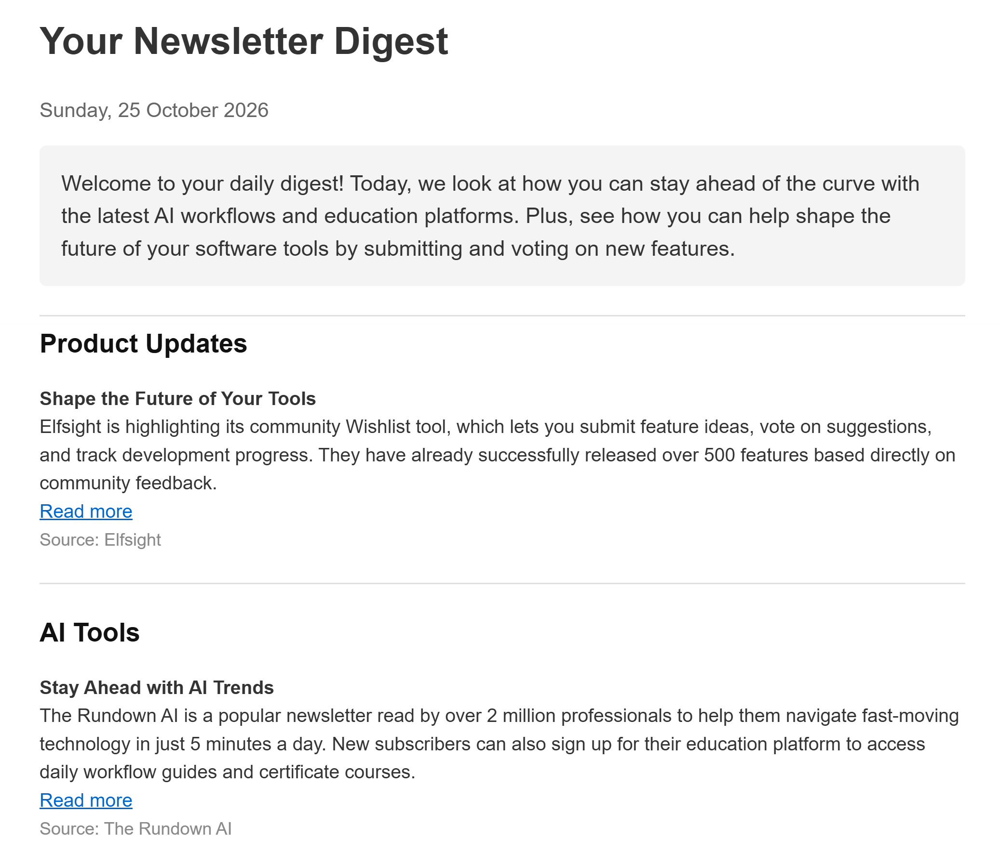
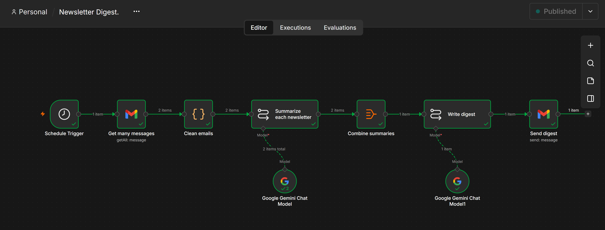

# 📬 AI Newsletter Digest (n8n + Gemini)

An n8n workflow that reads all your newsletters from Gmail every morning, uses Google Gemini to pull out the key stories, and emails you **one clean digest**: duplicates merged, stories grouped by topic, links to the originals.

> Built as part of my **30-Day Workflow Challenge**. Inspired by a real client request: *"I get a batch of newsletters every day and I want them summarized and consolidated."*



---

## ✨ What it does

- 📥 Collects every newsletter from the last 24 hours (using a Gmail label)
- 🧹 Cleans the messy HTML into plain text and removes unsubscribe/footer links
- 🤖 Gemini summarizes each newsletter and skips ads and sponsored sections
- 🔗 Merges the same story when it appears in more than one newsletter
- 🗂️ Groups stories by topic with a short overview of the day
- 📧 Sends one well-designed HTML email every morning at 7am

---

## 🔄 Workflow



```
Schedule Trigger (7am daily)
   → Gmail: Get many messages   (label:Newsletters newer_than:1d)
   → Code: Clean emails         (HTML → plain text, keep article links)
   → Basic LLM Chain + Gemini   (summarize each newsletter)
   → Aggregate                  (combine all summaries into one)
   → Basic LLM Chain + Gemini   (write the final HTML digest)
   → Gmail: Send a message      (deliver the digest)
```

---

## 🛠️ Tech stack

| Tool | Purpose |
|---|---|
| **n8n** (self-hosted with Docker) | Workflow automation |
| **Gmail** | Source of newsletters + delivery of digest |
| **Google Gemini** (Flash model, free tier) | Summarizing and writing the digest |
| **JavaScript** (Code node) | Cleaning email HTML |

---

## 🚀 Setup

### 1. Label your newsletters in Gmail
Create a Gmail filter (search bar → sliders icon) with the newsletter senders in **From**, for example:

```
news.n8n.io OR tldrnewsletter.com OR therundown.ai
```

Then **Create filter** → **Apply the label** → `Newsletters` → tick **Also apply filter to matching conversations**.

### 2. Run n8n

```bash
docker volume create n8n_data
docker run -it --rm --name n8n -p 5678:5678 -v n8n_data:/home/node/.n8n docker.n8n.io/n8nio/n8n
```

Open http://localhost:5678

### 3. Import the workflow
In n8n: **Create workflow** → **⋯ (top right)** → **Import from File** → choose `newsletter-digest-workflow.json`.

### 4. Connect your credentials
- **Gmail** nodes → connect your Gmail account
- **Google Gemini Chat Model** nodes → add a free API key from [Google AI Studio](https://aistudio.google.com)

### 5. Personalise
- **Send digest** node → set **To** to your email address
- **Schedule Trigger** → change the time if you want
- **Workflow Settings** → set your timezone

### 6. Test, then activate
Click **Execute workflow** to test, then switch the workflow to **Active**.

---

## 📝 Notes

- **Free to run:** uses Gemini's free tier (Flash models). Note that free-tier inputs may be used by Google to improve its products, so only use it with public newsletters.
- **Self-hosted:** when running on a laptop, the workflow only runs while n8n is running. For 24/7 use, deploy n8n to a server or use n8n Cloud.
- **No invented links:** Gemini is instructed to use only links found in the original newsletters.

---

## 🔮 Possible improvements

- Send the digest to Slack or Telegram instead of email
- Save stories to Google Sheets or Notion to build a searchable archive
- Let the reader choose topics they care about
- Weekly "best of" digest

---

## 👤 Author

**Day 1** of my 30-Day Workflow Challenge. Follow along for a new automation every day.
